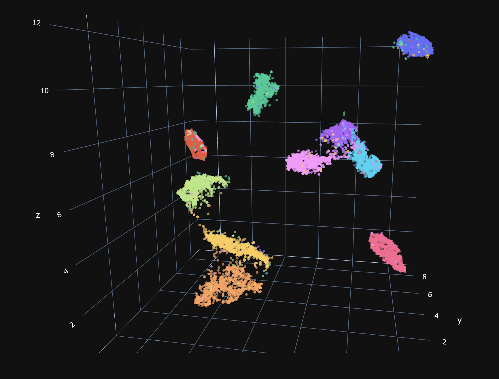
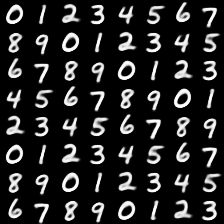
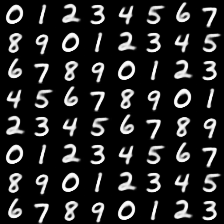

# VAE from Scratch in C++



*The 32-dimensional latent representations learned by my CNN-VAE, projected into 3D with **unsupervised UMAP**. Each point is an encoded MNIST image. Digit labels were used **only after projection**, to color the points—not to train the VAE or create the UMAP embedding.*

I started this project to understand **generative models from the underlying mathematics**, rather than relying on a machine-learning framework. What began as a fully connected autoencoder became a variational autoencoder (VAE), then a convolutional VAE with **convolutions, transposed convolutions, gradients, and Adam implemented in C++ using Eigen**.

The most interesting result so far isn't just reconstructing handwritten digits: the unsupervised model learned a latent representation with visible digit-related structure. By locating digit clusters in the **original 32D latent space**, I can decode representative vectors for each class and generate nearby variations.

**No PyTorch or TensorFlow is used for the model, differentiation, or optimizer.** Python, NumPy, scikit-learn, UMAP, and Plotly are used only for offline analysis and visualization of features exported from C++.

## Results at a glance

### Generation from class centroids

| Class centroids — no variation (`α = 0`) | Local variations (`α = 0.1`) |
| :---: | :---: |
|  |  |

Every digit from **0 to 9** is generated by feeding its estimated **32D class centroid** into the CNN decoder. With `α = 0`, the same class always gives the same output. With `α = 0.1`, independent Gaussian perturbations produce variations in handwriting and shape.

These are **post-hoc, label-guided latent samples**, *not* unconditional generations from the standard normal prior and *not* a classifier or a conditional VAE. Labels are used only to compute the ten centroids **after** the unsupervised VAE has finished training.

### Status

- [x] Fully connected autoencoder on MNIST
- [x] Fully connected VAE with reparameterization and analytical KL divergence
- [x] Manual matrix-based backpropagation and Adam optimizer
- [x] CNN encoder: two strided convolutions and Gaussian latent heads
- [x] CNN decoder: dense projection and two transposed convolutions
- [x] Manual convolution and transposed-convolution gradients
- [x] `im2col` / matrix multiplication optimization for convolutions
- [x] Matrix multiplication + scatter/gather optimization for transposed convolutions
- [x] MNIST reconstruction, posterior sampling, and prior sampling
- [x] Export of 32D latent vectors with aligned MNIST labels
- [x] PCA and unsupervised 3D UMAP visualization
- [x] Class-centroid decoding and local latent variations
- [ ] Interactive 3D latent explorer (React Three Fiber)
- [ ] Denoising diffusion probabilistic model (DDPM)
- [ ] Potential learned latent prior / latent diffusion

---

## 1. How the project evolved

I built the model in stages so I could understand—and debug—every mathematical component before moving to a more expressive architecture.

1. **Dense autoencoder:** learn an encoder and decoder using reconstruction loss.
2. **Dense VAE:** introduce Gaussian latent variables, the reparameterization trick, KL regularization, and the full backward pass.
3. **Convolutional encoder:** preserve image structure using learned spatial filters instead of flattening immediately.
4. **Convolutional decoder:** replace dense pixel prediction with transposed convolutions that progressively recover spatial resolution.
5. **Optimize the implementation:** replace slow scalar convolution loops with matrix multiplications, retaining explicit control of indexing and gradients.
6. **Investigate the learned space:** export latent means, visualize them in 3D, and decode representative class regions.

### Original fully connected VAE (first working model)

```text
Image: 1 × 28 × 28
        │ flatten
      (784)
        │ Dense + ReLU
       (64)
       /   \
    μ (64)  log σ² (64)
       \   /
  z = μ + exp(log σ² / 2) ⊙ ε       ε ~ N(0, I)
        │ Dense + ReLU
       (64)
        │ Dense + Sigmoid
      (784)
        │
  Reconstructed image
```

This version used a hidden size and latent size of 64. It established the VAE mathematics and manual differentiation before I introduced convolutions.

**Historical dense-VAE result (one training minibatch after 30,000 steps):** reconstruction BCE `61.59`, KL `27.64`, total `89.23`, using `B = 64` and Adam with `lr = 0.0003`. These are *training-minibatch* values, not a test-set benchmark, and should not be directly compared with the later architecture without controlling for training setup.

---

## 2. Current architecture: CNN-VAE

The current model operates on **binarized 28 × 28 MNIST images**. It has a separate **32-dimensional latent bottleneck**, independent of the intermediate feature width.

```text
ENCODER                                            Shape per sample
──────────────────────────────────────────────────────────────────
Input image                                         (1, 28, 28)
Conv2D(1 → 32, kernel=4, stride=2, padding=1)       (32, 14, 14)
ReLU
Conv2D(32 → 64, kernel=4, stride=2, padding=1)      (64, 7, 7)
ReLU
Flatten                                            (3136)
       ├── Dense → μ                               (32)
       └── Dense → V = log(σ²)                     (32)
Sample z = μ + exp(V/2) ⊙ ε, ε ~ N(0,I)             (32)

DECODER
──────────────────────────────────────────────────────────────────
Dense(32 → 3136) + ReLU                            (3136)
Unflatten                                          (64, 7, 7)
ConvTranspose2D(64 → 32, k=4, s=2, p=1) + ReLU     (32, 14, 14)
ConvTranspose2D(32 → 1, k=4, s=2, p=1)             (1, 28, 28)
Flatten + Sigmoid                                  (784 probabilities)
```

For a batch size of `B = 64`, the main tensor shapes are:

| Stage | Batch shape |
| --- | --- |
| Input `X` | `(B, 784)` |
| Encoder input | `(B, 1, 28, 28)` |
| First convolution output | `(B, 32, 14, 14)` |
| Second convolution output | `(B, 64, 7, 7)` |
| Flattened features `H` | `(B, 3136)` |
| `M`, `V`, `E`, `Z` | `(B, 32)` |
| Decoder dense output | `(B, 3136)` |
| Decoder first transposed convolution | `(B, 32, 14, 14)` |
| Final output | `(B, 784)` |

The key dense parameter shapes are `Wμ, Wv ∈ ℝ^(3136×32)` and `W2 ∈ ℝ^(32×3136)`. The current decoder **does not use the old dense output layer `W3`**.

For the convolution settings above, the spatial shape equations are:

```math
H_{\mathrm{conv}}=\left\lfloor\frac{H+2P-K}{S}\right\rfloor+1,
\qquad
H_{\mathrm{deconv}}=(H-1)S-2P+K.
```

With `K = 4`, `S = 2`, `P = 1`, the encoder goes `28 → 14 → 7` and the decoder goes `7 → 14 → 28`.

### Tensor layout

I represent image batches using `Eigen::Tensor<float, 4, Eigen::RowMajor>` with axes **`(B, C, H, W)`**. Dense operations use `Eigen::MatrixXf`.

An important detail is that Eigen matrices and tensors do **not** necessarily have the same physical memory layout. Rather than assuming that a raw buffer can be reinterpreted safely, I implemented explicit `matrixToTensor`, `flatten`, and `unflatten` operations that preserve the logical `(channel, row, column)` indexing. This is also essential when propagating decoder gradients back through the dense-to-convolution transition.

---

## 3. VAE mathematics and training objective

### Gaussian encoder and reparameterization

The encoder predicts a diagonal Gaussian posterior:

```math
q_\phi(z\mid x)=\mathcal N\!\left(\mu_\phi(x),\operatorname{diag}(\sigma_\phi^2(x))\right),
\quad V=\log\sigma^2.
```

For a batch, using the flattened convolutional features `H`:

```math
M=HW_\mu+b_\mu,\qquad V=HW_v+b_v.
```

I use the reparameterization trick to sample without breaking gradient propagation:

```math
E\sim\mathcal N(0,I),\qquad
\boxed{Z=M+\exp(V/2)\odot E}.
```

This moves the randomness into `E` and makes `Z` differentiable with respect to the encoder's predicted mean and log-variance.

### ELBO, reconstruction loss, and KL

The evidence lower bound is:

```math
\log p_\theta(x)\geq
\mathbb E_{q_\phi(z\mid x)}[\log p_\theta(x\mid z)]
-D_{\mathrm{KL}}(q_\phi(z\mid x)\,\|\,p(z)),
\qquad p(z)=\mathcal N(0,I).
```

The current implementation uses a **β-weighted negative ELBO-style objective**:

```math
\boxed{\mathcal L=\mathcal L_{\mathrm{rec}}+\beta\mathcal L_{\mathrm{KL}}}.
```

The reconstruction loss is Bernoulli binary cross-entropy **summed over 784 pixels, then averaged over the batch**:

```math
\mathcal L_{\mathrm{rec}}=-\frac1B\sum_{b=1}^B\sum_{j=1}^{784}
\big[x_{bj}\log\hat x_{bj}+(1-x_{bj})\log(1-\hat x_{bj})\big].
```

The closed-form diagonal-Gaussian KL is:

```math
\boxed{
\mathcal L_{\mathrm{KL}}=\frac1{2B}\sum_{b=1}^B\sum_{k=1}^{d}
\left(M_{bk}^{2}+e^{V_{bk}}-1-V_{bk}\right)
}.
```

With `β = 1`, this is the standard VAE negative-ELBO objective (using a Monte Carlo sample for the expected reconstruction term). The latest shared CNN-VAE configuration used **`β = 0.4`** to experiment with the reconstruction–regularization tradeoff. These loss terms have different scales, so changing β is not equivalent to changing the learning rate.

### Deriving the KL term

For one latent coordinate, the Gaussian-to-standard-normal divergence is:

```math
D_{\mathrm{KL}}\big(\mathcal N(\mu,\sigma^2)\,\|\,\mathcal N(0,1)\big)
=\frac12\left(\mu^2+\sigma^2-1-\log\sigma^2\right).
```

Substituting `V = log σ²` and summing over the latent coordinates gives the expression above, without having to estimate KL by sampling.

### Manual backward pass

The decoder produces logits `Y`, then pixel probabilities `X̂ = sigmoid(Y)`. Binary cross-entropy and sigmoid give the simplified reconstruction gradient:

```math
\boxed{G_Y=\frac{\hat X-X}{B}}.
```

In the original dense VAE, the decoder backward pass was:

```math
\begin{aligned}
G_{W_3}&=H_2^TG_Y,&G_{b_3}&=\sum_bG_Y[b,:],\\
G_{H_2}&=G_YW_3^T,\\
G_{A_2}&=G_{H_2}\odot\mathbf1_{A_2>0},\\
G_{W_2}&=Z^TG_{A_2},&G_{b_2}&=\sum_bG_{A_2}[b,:],\\
G_Z&=G_{A_2}W_2^T.
\end{aligned}
```

In the current CNN-VAE, `G_Y` instead propagates **through transposed convolution 2, ReLU, transposed convolution 1, flatten, and the decoder dense layer** before producing `G_Z`. The latent-space derivatives themselves remain the same, except for the explicit β factor:

```math
\boxed{G_M=G_Z+\beta\frac{M}{B}},
\qquad
\boxed{G_V=\frac12G_Z\odot e^{V/2}\odot E+\beta\frac{e^V-1}{2B}}.
```

The encoder-head gradients are:

```math
\begin{aligned}
G_{W_\mu}&=H^TG_M, & G_{b_\mu}&=\sum_bG_M[b,:],\\
G_{W_v}&=H^TG_V, & G_{b_v}&=\sum_bG_V[b,:],\\
G_H&=G_MW_\mu^T+G_VW_v^T.
\end{aligned}
```

Finally, `G_H` is unflattened into `(B,64,7,7)` and propagated backwards through the two encoder convolutions and their ReLUs.

**Batch normalization of the loss happens once.** Since `G_Y` already contains `1/B`, the reconstruction gradient must *not* be divided by `B` again inside each convolution, matrix multiplication, or optimizer update. The analytical KL gradients separately contain their own `1/B` factors.

---

## 4. Convolution from scratch—and why I switched to `im2col`

### First implementation: explicit loops

The forward operation in `conv.cpp` follows the cross-correlation convention used by most neural-network frameworks (the kernel is not flipped):

```math
Y_{b,o,i,j}=b_o+\sum_{c=1}^{C_{\rm in}}\sum_{u=0}^{K-1}\sum_{v=0}^{K-1}
W_{o,c,u,v}\,X_{b,c,iS+u-P,jS+v-P},
```

where out-of-bounds input coordinates contribute zero. The filter tensor has shape `(Cout, Cin, K, K)`.

The corresponding gradients are conceptually straightforward:

```math
\begin{aligned}
\frac{\partial L}{\partial W_{o,c,u,v}}
&=\sum_{b,i,j}X_{b,c,iS+u-P,jS+v-P}\,G_{Y,b,o,i,j},\\
\frac{\partial L}{\partial b_o}&=\sum_{b,i,j}G_{Y,b,o,i,j}.
\end{aligned}
```

Input gradients accumulate over all output positions whose receptive field includes each input pixel. I started with nested loops because they made every index and derivative easy to check. The drawback was performance: the loops repeatedly performed scalar multiplications and memory accesses across the batch, channels, and kernel dimensions.

### Optimization: convert convolution into matrix multiplication

`im2col` rearranges every input patch into a row of a matrix:

```text
Xcol  : (B × Hout × Wout, Cin × K × K)
Wmat  : (Cin × K × K, Cout)
Ymat  = Xcol × Wmat
      : (B × Hout × Wout, Cout)
```

After adding the biases, I rearrange `Ymat` back to `(B,Cout,Hout,Wout)`.

For example, the second encoder convolution uses `Cin=32`, `Cout=64`, `K=4`, and a `7×7` output. With `B=64`:

```text
Xcol : (64 × 7 × 7, 32 × 4 × 4) = (3136, 512)
Wmat : (512, 64)
Ymat : (3136, 64)
```

The weight and patch gradients become two more matrix multiplications:

```math
\boxed{G_{W\mathrm{mat}}=X_{\mathrm{col}}^TG_{Y\mathrm{mat}}},
\qquad
\boxed{G_{X\mathrm{col}}=G_{Y\mathrm{mat}}W_{\mathrm{mat}}^T}.
```

`col2im`-style scatter accumulation maps `G_Xcol` back into the input tensor. It must **sum overlapping contributions**, not overwrite them.

This kept the same mathematics while moving the expensive multiply-accumulate work to Eigen's optimized matrix multiplication. It still incurs memory overhead from materializing patches; this is a speed/memory tradeoff, not an asymptotic reduction in the amount of arithmetic.

---

## 5. Transposed convolutions: learning to upsample

The CNN decoder needs to turn the `64×7×7` feature tensor back into a `1×28×28` image. I implemented two **transposed convolutions** rather than using a final dense output layer.

For each input activation, the transposed convolution *scatters* weighted contributions onto its output kernel footprint:

```math
Y_{b,o,iS+u-P,jS+v-P}\mathrel{+}=
X_{b,c,i,j}W_{o,c,u,v},
```

summed over valid input channels, output channels, and kernel offsets, with the output bias added once per output position. Overlapping contributions are summed. A transposed convolution is the transpose/adjoint of the linear convolution operation for compatible shapes; it is **not** a true inverse that recovers lost information.

The first working version used explicit scatter loops for forward propagation and matching backward loops:

```math
\begin{aligned}
G_{W,o,c,u,v}&\mathrel{+}=X_{b,c,i,j}\,G_{Y,b,o,iS+u-P,jS+v-P},\\
G_{X,b,c,i,j}&\mathrel{+}=W_{o,c,u,v}\,G_{Y,b,o,iS+u-P,jS+v-P}.
\end{aligned}
```

### Faster version: GEMM + scatter/gather

The optimized implementation packs all input activations and filter weights into matrices:

```text
Xmat    : (B × Hin × Win, Cin)
Wmat    : (Cin, Cout × K × K)
patches = Xmat × Wmat
         : (B × Hin × Win, Cout × K × K)
```

A spatial **scatter** then accumulates those output patches into the image. In backward propagation, I **gather** the upstream output gradients into a patch-gradient matrix `dP` with the same arrangement (invalid spatial locations contribute zero):

```math
\boxed{G_{W\mathrm{mat}}=X_{\mathrm{mat}}^T\,dP},
\qquad
\boxed{G_{X\mathrm{mat}}=dP\,W_{\mathrm{mat}}^T}.
```

The code then reshapes these gradients back into the original tensor/weight layouts and sums the output gradients for the bias. This was a direct response to the very slow training caused by the first scalar-loop transposed convolution implementation.

Both convolution directions still use explicit memory rearrangement, but the large dot products are handled by Eigen. I have not included an unverified benchmark or speedup number here.

---

## 6. Adam optimizer, numerical stability, and debugging

### Adam implemented manually

For every trainable dense matrix, bias, convolution kernel, and transposed-convolution kernel, I maintain first and second moments:

```math
\begin{aligned}
m_t&=\beta_1m_{t-1}+(1-\beta_1)g_t,\\
v_t&=\beta_2v_{t-1}+(1-\beta_2)g_t^{\odot 2},\\
\hat m_t&=\frac{m_t}{1-\beta_1^t},\qquad
\hat v_t=\frac{v_t}{1-\beta_2^t},\\
\theta_t&=\theta_{t-1}-\eta\frac{\hat m_t}{\sqrt{\hat v_t}+\epsilon}.
\end{aligned}
```

Every square, square root, and division is elementwise. A single Adam timestep is advanced **per minibatch**, not once per layer. For tensor kernels, the moment tensors have the same `(Cout,Cin,K,K)` layout as the weights.

### Bug 1: unexpectedly huge loss at initialization

One of the hardest problems appeared after switching to convolutions. In a diagnostic run, the first minibatch had an enormous loss:

| Initial training-step measurement (before fix) | Value |
| --- | ---: |
| Reconstruction BCE | `10,852.7` |
| KL | `1.99 × 10^15` |
| Total (`β = 0.4`) | `7.96 × 10^14` |

The cause was an important Eigen detail: in the tensor API I was using, `Tensor4D::setRandom()` produced random numbers in approximately **`[0,1]`**, whereas `MatrixXf::Random()` produces values in approximately `[-1,1]`. Multiplying tensor values by a scale didn't make them zero-mean. The largely positive convolutional filters amplified activations through successive layers, leading to huge Gaussian parameters and KL divergence.

I corrected the tensor initialization by centering the random values and using a variance-scaled range:

```cpp
W.setRandom();
const float bound = std::sqrt(6.0f / float(Cin * K * K));
for (Eigen::Index i = 0; i < W.size(); ++i)
    W.data()[i] = (2.0f * W.data()[i] - 1.0f) * bound;
```

This is a **He-uniform-style initialization** for the convolution filters. After restarting from fresh weights and optimizer state, the model trained much more sensibly, with recognizable MNIST reconstructions after roughly **2,000 steps** in the subsequent experiment.

*Implementation note:* uniform initialization requires accounting for the variance of the uniform distribution. For a matrix initialized with `MatrixXf::Random()` in `[-1,1]`, a standard Xavier-uniform bound is `sqrt(6 / (fan_in + fan_out))`; the differently scaled `sqrt(2 / (fan_in + fan_out))` is not the same initialization.

### Bug 2: leftovers from the dense architecture

When replacing the decoder, I also had to remove or stop updating obsolete dense weights (`W3`, `b3`), update gradient and Adam moment shapes to use `LATENT_SIZE` and `FEATURE_SIZE`, and correct random generation to sample `(B,LATENT_SIZE)` instead of the old `H_size`. Shape errors are especially dangerous when release builds disable Eigen's debug assertions.

### Bug 3: reconstruction improved while total loss got worse

In an earlier run, the reconstruction term continued falling while the KL term grew sharply. That is possible because the network can learn to encode images accurately in a latent distribution that matches the standard Gaussian prior poorly.

**Better reconstruction does not necessarily mean better prior sampling.** The reconstruction/regularization tradeoff is why I monitor BCE and KL **separately**, rather than looking only at their weighted sum. With the VAE, large positive log-variances can also make `exp(V)` overflow; using an excessively aggressive learning rate (e.g. `0.003` instead of `0.0003`) exposed numerical instability.

For the current experiments, I use **Adam with `lr = 0.0003`** and investigate different KL weights. Numerical training values reported in this README are historical experiment observations, not an independently evaluated model benchmark.

---

## 7. Reconstruction vs. truly new generation

These operations use the **same trained decoder** but give it different latent inputs:

| Operation | Where `z` comes from | What it tests |
| --- | --- | --- |
| Deterministic reconstruction | `z = μ(x)` | How well information about a particular input image is preserved |
| Posterior sample / stochastic reconstruction | `z ~ qφ(z\|x)` | Reconstruction with encoder uncertainty |
| Unconditional generation | `z ~ N(0,I)` | Whether the learned representation works with the specified prior |
| Class centroid decoding | `z = cₖ` | Representative sample based on labeled latent means |
| Local class variation | `z = cₖ + α ε` | Diversity around a known latent region |

The first two receive information from a real MNIST image. **Only prior sampling is unconditional generation** in the usual VAE sense.

I found that posterior reconstructions could be convincing while unconditioned standard-normal samples were substantially worse. This isn't contradictory: the decoder is trained primarily on codes drawn from the encoder's posteriors, which may not match `N(0,I)` closely in practice, particularly under weaker KL regularization. This motivated exploring the actual latent geometry instead of relying only on the assumed prior.

---

## 8. Exporting and visualizing the learned latent space

### What I export from C++

I use the model's **posterior mean vectors**, not the intermediate convolution features or one-off noisy latent samples:

```text
forward.H   -> (B, 3136)   convolutional features
forward.M   -> (B, 32)     posterior latent means  <-- export this
forward.Z   -> (B, 32)     stochastic posterior samples
```

The `make_batch_mnist` loader was extended with an optional `std::vector<int>* sampledIndices` argument. It records the original MNIST image indices alongside the sampled rows. I then load the matching MNIST IDX1 label file, which has the same source-image ordering, and export two aligned files:

```text
latent_means.csv   N rows × 32 columns (floating-point latent means)
latent_labels.csv  N rows × 1 column  (integer digits 0...9)
```

The CSV row order matters: **row `i` in both files must refer to the same image**. I use the same input preprocessing (binarization) when extracting embeddings as during VAE training. Random batching samples with replacement, so for rigorous neighborhood evaluation I'd export every test image exactly once.

### Why PCA wasn't enough

PCA finds three orthogonal linear directions retaining as much variance as possible, but it discards 29 of the original 32 dimensions. Two images that look close in a 3D PCA plot can remain far apart in the full latent space. PCA also doesn't optimize for class separation.

I compared PCA with **UMAP**, which builds a low-dimensional representation intended to preserve aspects of local neighborhood structure. UMAP produced a much more visually separated arrangement of MNIST digit regions. However, UMAP can distort global distances and exaggerate visual cluster separation; the plot is a view of the representation, not a proof that the original 32D clusters are disjoint.

Crucially, the projection is **unsupervised**:

```python
import numpy as np
import umap

Z = np.loadtxt("latent_means.csv", delimiter=",")
labels = np.loadtxt("latent_labels.csv", delimiter=",", dtype=int).reshape(-1)
assert Z.shape[0] == labels.size and np.isfinite(Z).all()

reducer = umap.UMAP(
    n_components=3,
    n_neighbors=30,
    min_dist=0.1,
    metric="euclidean",
    random_state=42,
)
Z3 = reducer.fit_transform(Z)  # No labels passed to UMAP!
```

Plotly is used afterward to color the points by their known MNIST labels. That makes it possible to see whether digit-related groupings emerged **without supervising the encoder on digit identity**.


To check whether the groupings are genuine rather than projection artifacts, the next quantitative analysis would be to compare label purity among nearest neighbors in the **original 32D space**, ideally on a nonduplicated held-out dataset.

---

## 9. From latent clusters to generated digits

### Compute centroids in **32D**, not in projected 3D

UMAP isn't a generally invertible mapping. A point selected in the 3D plot does not uniquely specify the 32D code needed by the decoder. Therefore, I compute each digit's centroid **before** projection, directly from the exported encoder means.

For digit class `k`:

```math
\boxed{c_k=\frac1{N_k}\sum_{i:y_i=k}\mu_\phi(x_i)},
\qquad c_k\in\mathbb R^{32}.
```

The VAE itself never used class labels during training; I use them **post hoc** to group its learned representations. The ten centroids form a `10 × 32` matrix:

```python
import numpy as np

Z = np.loadtxt("latent_means.csv", delimiter=",")
labels = np.loadtxt("latent_labels.csv", delimiter=",", dtype=int).reshape(-1)
centroids = np.stack([Z[labels == k].mean(axis=0) for k in range(10)])
np.savetxt("digit_centroids.txt", centroids, fmt="%.9g")
```

I load those 32D vectors into C++, assign one centroid to each sample, and run **only the trained decoder**. The digit order is deliberately repeated with `digit = i % 10`.

### Add local variation

To create different renderings from the same region, I perturb the centroid:

```math
\boxed{z=c_k+\alpha\epsilon},\qquad \epsilon\sim\mathcal N(0,I).
```

- **`α = 0`**: one deterministic prototype per digit; repetitions are identical.
- **`α = 0.1`**: small random perturbations around the prototype, producing related but visibly different handwritten digits.

| `α = 0` — centroid decoding | `α = 0.1` — local generation |
| :---: | :---: |
|  |  |

This is a practical way to explore a trained VAE with imperfect unconditional prior sampling. It has limitations: the mean of a multimodal class might lie between meaningful regions; arbitrary perturbations can leave the class manifold; and using labels for centroids is **not equivalent to training a conditional VAE**. A mixture model or learned diffusion prior could model the latent distribution more flexibly.

### Towards an interactive portfolio

An interesting next step is a **React Three Fiber** visualization where visitors rotate the UMAP point cloud, hover to preview individual examples, click a point to retrieve its **original 32D vector**, and generate variations from that vector. The plot coordinates are for navigation; the decoder should always receive the real full-dimensional latent code, not the 3D UMAP coordinates.

---

## 10. Running the project and reproducing the analysis

### Dependencies

- C++17 compiler
- Eigen 3 (`Eigen/Dense` and `unsupported/Eigen/CXX11/Tensor`)
- `stb_image_write` for output PNGs
- MNIST raw IDX images (and corresponding IDX1 labels for labeled visualization)
- For **offline visualization only**: Python, NumPy, scikit-learn, `umap-learn`, Plotly (and pandas if saving tabular plots)

For the visualization dependencies:

```bash
python -m pip install numpy scikit-learn umap-learn plotly pandas
```

The C++ source is split into `main.cpp`, `network.{h,cpp}`, `conv.{h,cpp}`, `tensor.{h,cpp}`, and the MNIST/image I/O code in `shape.{h,cpp}`. The model code is not dependent on Python packages.

The local implementation has **machine-specific MNIST/output and `stb_image_write` paths**, which should be updated to match your own directory layout before building. Compile all implementation files together with C++17 and the Eigen include directory; the exact build command depends on your Makefile/toolchain.

The analysis steps are:

1. Train the CNN-VAE on binarized MNIST with the corrected zero-mean convolution initialization.
2. Export `forward.M` and the aligned sample labels to `latent_means.csv` and `latent_labels.csv`.
3. Run PCA and UMAP on the **32D latent means**; color the resulting points with labels afterward.
4. Compute the ten 32D class centroids; save them in `digit_centroids.txt`.
5. Decode each centroid with `α = 0`, then repeat with `α = 0.1`.
6. Compare against ordinary posterior reconstruction and unconditional `N(0,I)` sampling.

The three figures at the top of this README correspond to those last two analysis stages and to the UMAP projection.

---

## 11. What's next?

**A better generative prior.** Centroid-based samples show that the decoder can produce convincing digits when given a latent vector from a meaningful region. I want to compare sampling strategies such as a fitted Gaussian mixture with the standard VAE prior, then potentially implement a small diffusion prior operating on the learned latent vectors.

**DDPM from scratch.** A separate denoising diffusion model would let me explore noise schedules, timestep conditioning, denoising objectives, and iterative generation directly. This has **not** been implemented yet.

**Latent diffusion and richer datasets.** Eventually, I'd like to test whether a learned prior over a larger or spatial latent representation can produce more detailed images on datasets beyond MNIST. That would likely require stronger autoencoding capacity and a more appropriate image likelihood than the current binarized-MNIST BCE setup.

**Interactive latent atlas.** The 3D UMAP result is a natural starting point for an interactive portfolio: browse encoded examples, inspect neighborhoods, and decode nearby 32D points in real time or from precomputed outputs.

---

## Tools and philosophy

**C++ · Eigen · MNIST · Manual differentiation · Adam · `im2col` · Transposed convolutions · Python/UMAP/Plotly for visualization**

This is primarily a project in understanding. I wanted to see the full path from a pixel, through convolutional filters, Gaussian sampling and an optimizer update, all the way to a meaningful latent representation—and understand precisely why things fail when a detail in that path is wrong.
